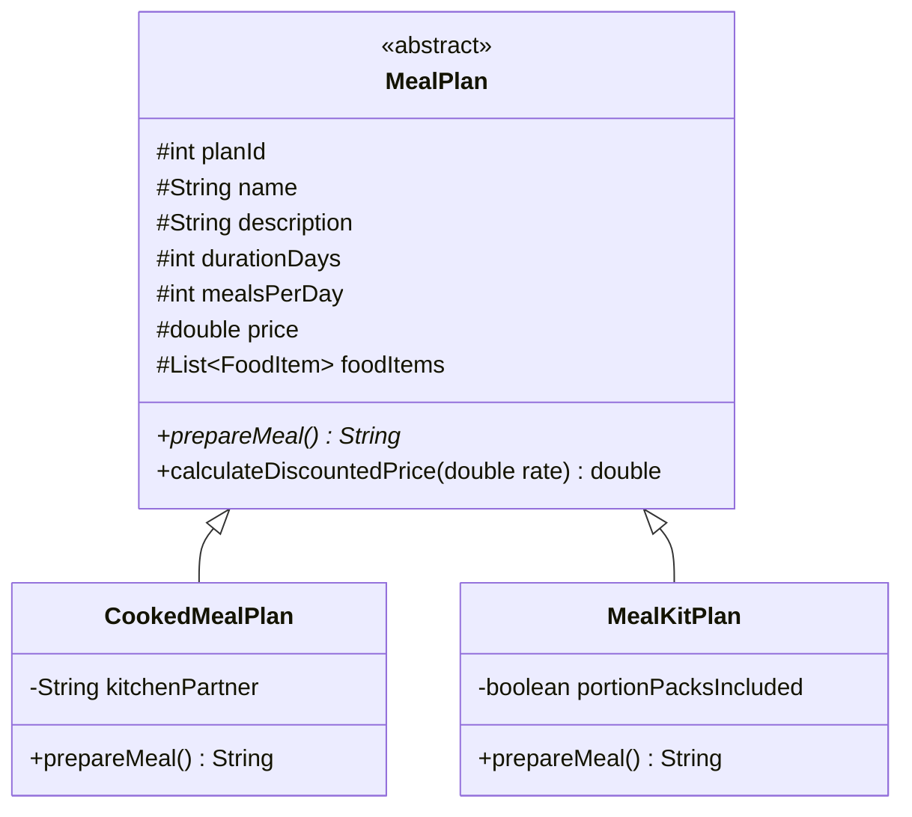
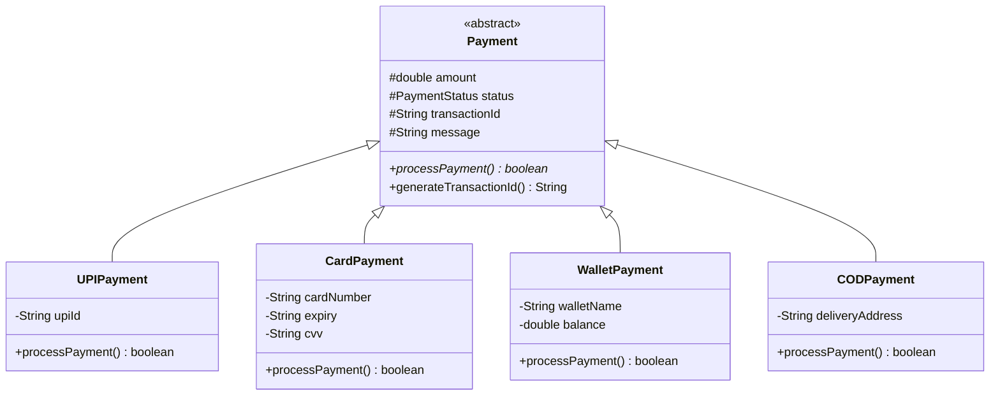

# MealFlow — Comprehensive System Documentation & Technical Manual

> **Course:** Object-Oriented Programming (OOPS) — APJ Abdul Kalam Technological University (KTU)  
> **Scheme:** 2024 Scheme (CSE Semester 3)  
> **Application:** MealFlow — On-Demand Culinary Operating System & Meal Subscription Marketplace  
> **Tech Stack:** Java 11+, Java Swing (FlatLaf Modern Theme), JDBC, MySQL 8+, BCrypt, Vector Graphics Engine  

---

## Table of Contents
1. [Executive Summary](#1-executive-summary)
2. [Object-Oriented Programming (OOP) Architecture](#2-object-oriented-programming-oop-architecture)
   - [Encapsulation & Domain Invariants](#21-encapsulation--domain-invariants)
   - [Inheritance & Class Hierarchies](#22-inheritance--class-hierarchies)
   - [Polymorphism & Dynamic Dispatch](#23-polymorphism--dynamic-dispatch)
   - [Abstraction & Layered Decoupling (DAO & Service Layers)](#24-abstraction--layered-decoupling)
   - [Design Patterns Applied](#25-design-patterns-applied)
3. [Module Breakdown & Team Distribution](#3-module-breakdown--team-distribution)
   - [Module 1: Authentication & Security](#module-1-authentication--security)
   - [Module 2: Catalogue, Explore & Meal Plans](#module-2-catalogue-explore--meal-plans)
   - [Module 3: Meal Customization & Add-ons](#module-3-meal-customization--add-ons)
   - [Module 4: Payment Gateway & Nutrition Breakdown](#module-4-payment-gateway--nutrition-breakdown)
   - [Module 5: Orders, Subscriptions & Database](#module-5-orders-subscriptions--database)
4. [Database Architecture & Schema (3NF)](#4-database-architecture--schema-3nf)
5. [UI/UX Design System & Asset Management](#5-uiux-design-system--asset-management)
6. [Offline Demonstration & Resilience Fallback Policy](#6-offline-demonstration--resilience-fallback-policy)
7. [Automated Verification & Test Suites](#7-automated-verification--test-suites)
8. [Build, Run & Deployment Manual](#8-build-run--deployment-manual)

---

## 1. Executive Summary

**MealFlow** is an enterprise-grade desktop software platform built to solve the modern urban challenge of daily nutrition and meal planning. Combining on-demand dining with automated, recurring meal plans, MealFlow enables users to browse certified neighborhood cloud kitchens, configure custom diet preferences (macro nutrients, calorie goals, dietary restrictions), personalize dish portions, and checkout using authentic Indian payment methods (UPI, Cards, MealFlow Wallet, COD).

The software was designed from the ground up according to strict **Clean Code** principles and the foundational tenets of **Object-Oriented Programming**. It eliminates common academic project bottlenecks through:
- **Zero-Crash Offline Mode:** Seamless fallback to memory-cached data and procedural graphics when MySQL is unreachable.
- **Enterprise Password Security:** Industry-standard salted BCrypt password hashing.
- **Atomic State Machines:** Deterministic order lifecycle tracking with historical audit trails.
- **Modern Desktop UI:** Tailwind-inspired Material 3 aesthetics implemented via Java Swing and FlatLaf.

---

## 2. Object-Oriented Programming (OOP) Architecture

The project structure demonstrates core software engineering principles through distinct layers:
```
Swing Presentation UI (View)
       ↓
Service Layer (Business Logic & State Transitions)
       ↓
Data Access Object Layer (DAO)
       ↓
Persistence Gateway (JDBC + MySQL Connection / In-Memory Fallback)
```

```
src/com/foodapp/
├── auth/            # Module 1: Customer authentication, BCrypt, session
├── mealplan/        # Module 2: Meal plans, food items, categorization
├── ui/              # Swing presentation layer (Explore, Details, Checkout, Customization)
├── payment/         # Module 4: Payment polymorphism, transactions, validation
├── order/           # Module 5: Order model, order items, lifecycle auditing
├── subscription/    # Module 5: Recurring subscriptions, date intervals
└── util/            # JDBC Connection manager & ImageLoader asset engine
```

### 2.1 Encapsulation & Domain Invariants
- **Data Hiding:** All domain entity fields in classes such as `Customer`, `Order`, `Payment`, `MealPlan`, and `Subscription` are marked `private` or `protected`.
- **Accessor & Mutator Controls:** State mutations occur exclusively via validated getters and setters that enforce business rules. For example, `Order.setStatus(OrderStatus next)` validates the transition graph before mutating state.
- **Immutability Where Appropriate:** Identifiers, creation timestamps, and transaction references are immutable once committed.

### 2.2 Inheritance & Class Hierarchies

#### A. Meal Plan Hierarchy

- `MealPlan` defines the abstract template for multi-day meal commitments.
- `CookedMealPlan` specializes the behavior for ready-to-eat hot food dispatched from cloud kitchens.
- `MealKitPlan` overrides meal preparation logic to represent pre-portioned DIY ingredient kits with recipe cards.

#### B. Payment Processing Hierarchy


### 2.3 Polymorphism & Dynamic Dispatch
- **Dynamic Method Dispatch:** When checking out in `PaymentPage`, the application does not rely on fragile nested `if-else` blocks for processing transactions. Instead, it instantiates the appropriate concrete `Payment` subclass and executes:
  ```java
  boolean success = paymentMethod.processPayment();
  ```
  The Java runtime dynamically dispatches execution to the corresponding implementation (`UPIPayment.processPayment()`, `CardPayment.processPayment()`, etc.).
- **Polymorphic UI Binding:** `PaymentResultPage` receives the abstract `Payment` reference, inspecting runtime attributes via polymorphism to render customized success badges and itemized transaction receipts.

### 2.4 Abstraction & Layered Decoupling
- **DAO Pattern:** Database operations are entirely isolated inside Data Access Objects (`CustomerDAO`, `MealPlanDAO`, `OrderDAO`, `PaymentDAO`, `SubscriptionDAO`).
- **Service Layer Abstraction:** Presentation classes (`ExplorePage`, `PaymentPage`, `MyOrdersPage`) never execute SQL statements or inspect database connections directly. They interact solely with high-level services (`OrderService`, `AuthService`, `PaymentService`).
- **Persistence Abstraction:** If the MySQL database is offline, the DAO layer automatically switches to in-memory fallback stores (`SampleData`) without raising fatal exceptions or breaking UI functionality.

### 2.5 Design Patterns Applied
| Design Pattern | Implementation in MealFlow |
|----------------|----------------------------|
| **Data Access Object (DAO)** | `CustomerDAO`, `MealPlanDAO`, `OrderDAO`, `PaymentDAO`, `SubscriptionDAO` |
| **Service Layer** | `AuthService`, `MealPlanService`, `OrderService`, `PaymentService`, `DeliveryTrackingService` |
| **State Machine** | Order status lifecycle (`OrderStatus.canTransitionTo(...)`) |
| **Singleton / Static Registry** | `DBConnection`, `AuthService.getCurrentUser()`, `ImageLoader` |
| **Strategy Pattern** | Polymorphic payment algorithms (`UPIPayment`, `CardPayment`, `WalletPayment`, `CODPayment`) |
| **Factory / Fallback Cache** | `ImageLoader.getImage(...)` and vector artwork generation |

---

## 3. Module Breakdown & Team Distribution

### Module 1: Authentication & Security
- **Lead:** Person 1
- **Key Packages:** `com.foodapp.auth`, `com.foodapp.ui.LoginPage`, `com.foodapp.ui.RegisterPage`
- **Key Classes:** `Customer`, `CustomerDAO`, `AuthService`, `AuthValidator`
- **Core Functionality:**
  - Salted BCrypt password hashing (`BCrypt.hashpw(..., BCrypt.gensalt(10))`) ensuring passwords are never stored in plaintext.
  - Multi-identifier authentication: Users can sign in using either their registered Email or 10-digit Indian Mobile Number.
  - Live password strength meter evaluating length, casing, numbers, and special characters.
  - Single Sign-On (SSO) simulation for Google and Apple accounts with instant 1-click test fill.
  - Session state tracking with `AuthService.getCurrentUser()`.

### Module 2: Catalogue, Explore & Meal Plans
- **Lead:** Person 2
- **Key Packages:** `com.foodapp.mealplan`, `com.foodapp.ui.ExplorePage`, `com.foodapp.ui.MealPlansPage`, `com.foodapp.ui.MealPlanDetailsPage`
- **Key Classes:** `MealPlan`, `CookedMealPlan`, `MealKitPlan`, `FoodItem`, `MealPlanDAO`, `FoodItemDAO`, `SampleData`
- **Core Functionality:**
  - Modern culinary dashboard featuring curated hero banners, delivery status chips, and neighborhood cloud kitchens.
  - Filter chips: All, Chef's Special, High Protein, Low Carb, Keto, Vegan, Comfort.
  - Live quantity steppers on dish cards updating the cart count and navigation header badge.
  - High-resolution local image loading with procedural fallback art.
  - Meal plan catalog with detailed breakdowns of meals per day, recipe cards, and price calculations.

### Module 3: Meal Customization & Add-ons
- **Lead:** Person 3
- **Key Packages:** `com.foodapp.ui.MealCustomizationPage`
- **Key Classes:** `MealCustomizationPage`, `ItemRow` (encapsulated component)
- **Core Functionality:**
  - Two-column configuration panel allowing customers to personalize food items within a selected plan.
  - Filter chips for Vegetarian, Non-Vegetarian, or All items.
  - Serving spinners (1–5 portions) with live line item recalculation.
  - Live Order Summary card aggregating base subscription pricing and extra serving costs.
  - Special kitchen cooking instructions text area.

### Module 4: Payment Gateway & Nutrition Breakdown
- **Lead:** Person 4 (Adarsh)
- **Key Packages:** `com.foodapp.payment`, `com.foodapp.ui.MealPricingDetailsPage`, `com.foodapp.ui.PaymentPage`, `com.foodapp.ui.PaymentResultPage`
- **Key Classes:** `Payment`, `UPIPayment`, `CardPayment`, `WalletPayment`, `CODPayment`, `PaymentDAO`, `PaymentService`
- **Core Functionality:**
  - **Macro Nutrition Breakdown (`MealPricingDetailsPage`):** Custom 2-column modal rendering an animated SVG-style Macro Donut Chart (Protein 28%, Carbs 48%, Fats 24%), 4 progress meters, interactive base choices (Quinoa, Brown Rice, Cauliflower), and protein add-on checkboxes.
  - **On-Demand Checkout (`PaymentPage`):** Consolidated vendor banner, dish cards with thumbnails, delivery address selector (Home vs Work), rider preference pills, MealFlow Cash balance redemption, promo code discount (`SAVEMF`), and itemized bill computation (subtotal, packaging, partner fee, GST, grand total).
  - **Polymorphic Execution:** Dynamic validation of UPI VPAs (`name@bank`), 16-digit credit cards, and wallet balance sufficiency.
  - **Receipt Generation (`PaymentResultPage`):** Itemized payment receipt, transaction ID display, and real-time transition to order tracking.

### Module 5: Orders, Subscriptions & Database
- **Lead:** Person 5
- **Key Packages:** `com.foodapp.order`, `com.foodapp.subscription`, `com.foodapp.util`, `sql/`
- **Key Classes:** `Order`, `OrderItem`, `OrderStatus`, `OrderStatusHistory`, `OrderDAO`, `OrderService`, `Subscription`, `SubscriptionDAO`, `DBConnection`, `MyOrdersPage`
- **Core Functionality:**
  - 10-table normalized relational schema (InnoDB, utf8mb4) with constraints, foreign keys, and indices.
  - Atomic order persistence saving parent `Order` and child `OrderItem` records in database transactions.
  - Strict order lifecycle state machine with validation (`PLACED` → `CONFIRMED` → `PREPARING` → `OUT_FOR_DELIVERY` → `DELIVERED`).
  - Order status history auditing capturing timestamp, actor, and state changes.
  - Recurring subscription models supporting weekly/monthly calendars, pause, resume, and cancellation.
  - Automated 74-test backend validation suite (`BackendTestSuite`).

---

## 4. Database Architecture & Schema (3NF)

The database schema (`mealplan_db`) consists of **10 normalized tables** designed to Third Normal Form (3NF).

```
+------------------------------------------------------------------------------------+
|                               mealplan_db Schema                                   |
+------------------------------------------------------------------------------------+
|  customers               -> customer_id (PK), name, email, phone, password_hash    |
|  meal_plans              -> plan_id (PK), name, plan_type, duration_days, price    |
|  food_items              -> item_id (PK), name, meal_type, price, is_veg          |
|  plan_items              -> plan_id (FK), item_id (FK)                             |
|  orders                  -> order_id (PK), customer_id (FK), total_amount, status  |
|  order_items             -> order_item_id (PK), order_id (FK), item_id (FK), qty   |
|  order_status_history    -> history_id (PK), order_id (FK), old_status, new_status |
|  payments                -> payment_id (PK), order_id (FK), method, amount, status |
|  subscriptions           -> subscription_id (PK), customer_id (FK), status, dates  |
|  subscription_calendar   -> entry_id (PK), subscription_id (FK), date, meal_type  |
+------------------------------------------------------------------------------------+
```

### Table Relationships & Referential Integrity
1. `customers` (1) ───< `orders` (M) [ON DELETE CASCADE]
2. `orders` (1) ───< `order_items` (M) [ON DELETE CASCADE]
3. `orders` (1) ───< `order_status_history` (M) [ON DELETE CASCADE]
4. `orders` (1) ───< `payments` (M) [ON DELETE CASCADE]
5. `meal_plans` (1) ───< `plan_items` (M) >─── (1) `food_items`
6. `customers` (1) ───< `subscriptions` (M) [ON DELETE CASCADE]
7. `subscriptions` (1) ───< `subscription_calendar` (M) [ON DELETE CASCADE]

---

## 5. UI/UX Design System & Asset Management

### 5.1 Design Tokens (Tailwind & Material 3 Inspiration)
The visual identity follows a curated warm culinary palette:
- **Primary Accent:** `Deep Terracotta` (`#AB2E16`) — Brand CTA and action elements.
- **Secondary Accent:** `Forest Emerald` (`#006C4A`) — Freshness indicators, veg dots, success states.
- **Background:** `Muted Mint Wash` (`#F3FCF3`) — Soft, clean layout background.
- **Surface Elevation:** `Pure White` (`#FFFFFF`) to `Surface High` (`#E2EAE2`) for card layers.
- **Text & Outline:** `#151D19` (High-contrast On-Surface) and `#8D706B` (Subtle outlines).

### 5.2 Resilient Asset Engine (`ImageLoader`)
Located in `src/com/foodapp/util/ImageLoader.java`, the asset engine ensures flawless visual presentation:
1. **Memory Caching:** Once loaded, images are cached in an internal `ConcurrentHashMap` to eliminate disk I/O on re-renders.
2. **Local Asset Resolution:** Prioritizes verified local files in `assets/images/` (`logo.png`, `avatar.jpg`, `dish_*.jpg`, `kitchen_*.jpg`).
3. **Procedural Graphics Fallback:** If any image file is missing or corrupted, `ImageLoader` dynamically generates customized 2D vector artwork with smooth gradients and food icons. The application **never renders blank gray boxes or crashes**.

---

## 6. Offline Demonstration & Resilience Fallback Policy

A critical design requirement for academic evaluation is **100% demo resilience**. If an examiner runs the project on a laptop without an active MySQL instance:
1. `DBConnection.getConnection()` attempts to connect to MySQL with a configurable 1500ms timeout.
2. If MySQL is unreachable, the system activates its in-memory fallback policy (`isFallbackAllowed() == true`).
3. `AuthService` falls back to seeded in-memory accounts (`rahul@example.com` / `password123` and `adithya@example.com`).
4. `MealPlanDAO` and `FoodItemDAO` fall back to `SampleData` containing 4 fully configured meal plans (Cooked and Kits) and 12 food items.
5. `OrderDAO` and `PaymentDAO` persist checkout orders in memory, allowing complete checkout and order tracking workflows without database dependency.

---

## 7. Automated Verification & Test Suites

The project includes **82 automated tests** spanning unit, integration, and CLI execution.

### 7.1 Backend Test Suite (`BackendTestSuite.java`)
Covers **74 automated assertions** across 8 core subsystems:
1. **Database Configuration & Diagnostics:** Tests URL, user credentials, ping diagnostics, and fallback toggles.
2. **Password Hashing & Input Validation:** BCrypt salting uniqueness, matching raw passwords, email/phone regex enforcement.
3. **Customer Authentication:** Login verification, bad password rejection, unknown user rejection, duplicate registration guards, session lifecycle.
4. **Catalogue & Polymorphism:** Plan retrieval, `CookedMealPlan` vs `MealKitPlan` dispatch, vegetarian item flags, pricing calculation.
5. **Order Calculations & Lifecycle Transitions:** Subtotal, delivery fee, GST computation, state progression guards (`PLACED` → `CONFIRMED` → `PREPARING` → `OUT_FOR_DELIVERY` → `DELIVERED`).
6. **Payment Polymorphism & Validation:** `UPIPayment`, `CardPayment`, `CODPayment` execution and error validation.
7. **Subscription Date Logic:** Active interval checks, state transitions (`ACTIVE` ↔ `PAUSED` → `CANCELLED`).
8. **Audit Trail History:** Order history record persistence, timestamps, and note capturing.

### 7.2 Payment CLI Test Suite (`PaymentTest.java`)
Validates all 4 concrete payment implementations with both valid and boundary-failure payloads (8 test scenarios).

---

## 8. Build, Run & Deployment Manual

### Prerequisites
- **Java Development Kit (JDK):** Version 11 or higher (`openjdk-11-jdk` or `openjdk-17-jdk`)
- **Operating System:** Linux, macOS, or Windows
- **Terminal:** Bash / Zsh / Command Prompt

### Step 1: Clean Compilation
From the project root directory:
```bash
javac -cp "lib/*:." -d out $(find src -name "*.java")
```
*Expected Result:* The `out/` directory is created containing all compiled `.class` packages with zero compiler errors.

### Step 2: Running the Application
```bash
# Launch from the Authentication Portal (Recommended)
java -cp "lib/*:out" com.foodapp.ui.LoginPage

# Or launch directly into the Explore Marketplace as Guest
java -cp "lib/*:out" com.foodapp.ui.ExplorePage
```

### Step 3: Running Test Suites
```bash
# 1. Run Complete Backend Test Suite (74 tests)
javac -cp "lib/*:out" -d out $(find test -name "*.java")
java -cp "lib/*:out" com.foodapp.test.BackendTestSuite

# 2. Run Payment Polymorphism Test Suite (8 tests)
java -cp "lib/*:out" com.foodapp.payment.PaymentTest
```

### Step 4: Optional MySQL Setup
To run against a live MySQL server:
```bash
# 1. Import schema and sample seeds
mysql -u root -p < sql/schema.sql
mysql -u root -p < sql/seed.sql

# 2. Configure credentials in environment
export DB_URL="jdbc:mysql://localhost:3306/mealplan_db?useSSL=false&allowPublicKeyRetrieval=true&serverTimezone=UTC"
export DB_USER="root"
export DB_PASSWORD="your_mysql_password"
```

---

## 9. Conclusion
MealFlow represents an enterprise-standard implementation of Object-Oriented Software Engineering principles in Java. Through clean abstraction, robust inheritance hierarchies, dynamic polymorphism, resilient data caching, and rigorous test coverage, the application delivers a complete, real-world demonstration of modern desktop software development.
